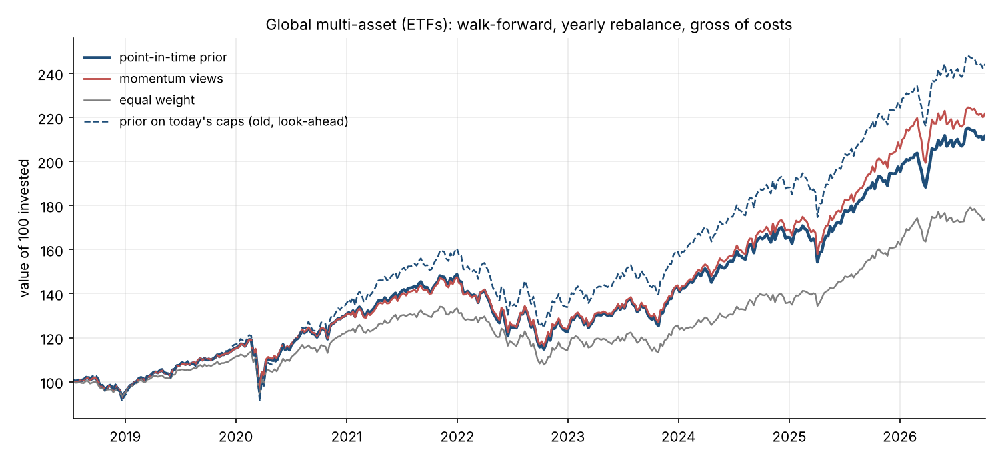

# Black-Litterman Portfolio Model

[](https://black-litterman-model.streamlit.app/)
[](https://www.python.org/)
[](LICENSE)
[](https://github.com/SunnyAlexV/Black-Litterman-model/actions/workflows/tests.yml)

**Start from the portfolio the market is already holding, then tilt it only as far as your views — and your confidence in them — justify.**

### ▶ [Try it live](https://black-litterman-model.streamlit.app/)



*Global multi-asset ETFs, walk-forward with yearly rebalancing, 2018 to today. The solid line is the equilibrium prior rebuilt at each rebalance from market caps as they stood **on that date**. The dashed line is the same model fed today's caps, which is what earlier versions of this app did. The gap between them is look-ahead bias. Regenerate the chart with `python reproduce_results.py`.*

---

## What makes this different from the other portfolio optimisers on GitHub

- **It found and fixed a look-ahead bias in its own prior.** Yahoo only reports *today's* market caps, and earlier versions built every historical prior from them, so a 2018 portfolio was handed the weights of the names that went on to win. That inflated backtested returns by **1.9pp a year on global ETFs and 11.2pp on the S&P 500 universe**. The prior now uses caps as they stood at each rebalance.
- **The implementation is validated against theory.** With no views, Black-Litterman must hold the market portfolio. On both ETF universes, where no constraint binds, the back-tested prior and the cap-weighted market finish identical to **0.00pp in all 37 three-year windows** tested.
- **"Did the views help?" gets an interval, not a point estimate.** A paired stationary block bootstrap and the Ledoit–Wolf (2008) HAC Sharpe test. Momentum's best case is +0.63pp a year with a 95% interval of **−0.34 to +1.67pp** (p = 0.24): no evidence of an edge in any of four universes.
- **243 headless tests in three suites, run by GitHub Actions on every push**, including *divergent-futures* tests: two price histories identical until a date and different after it must produce bit-identical decisions before that date. That proves "no look-ahead" by construction for the volatility overlay, the view engines and the market-cap prior.
- **Costs are an input and break-even is an output.** Gross by default. Set a one-way cost and every rebalance pays it, including the first purchase. The app also reports the cost at which a strategy's edge over its prior is used up, so you can compare it with your own broker instead of trusting a guess.
- **Every real-data number in this README is reproduced by one script**, [`reproduce_results.py`](reproduce_results.py), which writes [`results/results.md`](results/results.md). The numbers will drift as the data window moves forward, which is the honest behaviour.
- **Its own bugs are documented here**, including the look-ahead prior and one that made every rebalance frequency return the same answer, alongside a finding that a feature built here **cannot work** under the default objective.
- **ETF universes are included specifically because the stock universes carry survivorship bias** — and the README says which numbers you may believe and which you may not.

```bash
git clone https://github.com/SunnyAlexV/Black-Litterman-model
cd Black-Litterman-model
pip install -r requirements.txt
python test_bl_core.py            # numeric core
python test_pipeline.py           # end to end on synthetic data
python test_inference.py          # inference, costs, start dates (all three need no network)
python -m streamlit run black_litterman_portfolio.py
python reproduce_results.py       # real data: every figure in this README (~2 min)
```

## The idea in one paragraph

Mean-variance optimisation has a well-known failure mode: it is exquisitely sensitive to the expected returns you feed it. Small estimation errors produce wildly concentrated portfolios. Black-Litterman fixes this by changing the question. Rather than "what will each stock return?", it asks "what returns would justify what the market is currently holding?" — that is the equilibrium prior **π = δΣw**, obtained by reverse optimisation. Your views are then blended into that prior in proportion to how confident you are, using Bayes' rule. With no views you get the market portfolio back. With total confidence you get your view exactly. In between, you get a smooth, diversified, defensible tilt.

You can see this working in the app: the **Markowitz wt %** column sits next to the BL weights, and on live data it typically shows the classic corner solution — everything pinned at the weight cap or at zero — while Black-Litterman produces a graded portfolio from the same covariance matrix and the same constraints.

## What this app does, and what it deliberately leaves out

It answers one question: **given the market's own portfolio and whatever views you hold, how should the money be allocated?**

Costs are **off by default** and every figure is then gross. That is a deliberate default, not an omission: costs are broker-specific and vary with account size, venue and order size. Set a one-way cost in Advanced settings and every rebalance pays it on the value traded, including the first purchase from cash. More usefully, the backtest reports the **break-even cost** at which a strategy's edge is used up, so you can compare that one number with what your broker actually charges. Taxes, stamp duty and borrowing charges on shorts are not modelled at all.

## Features

### The model

- **Equilibrium prior** π = δΣw from cap-weighted market weights, with δ implied from the market's own realised risk premium (or set manually).
- **Absolute and relative views** — "RELIANCE will return 15%" or "HINDALCO beats VEDL by 10%" — entered in an editable table, activated per row.
- **Two Ω constructions**: **Idzorek** (you give a 0–100% confidence per view and ω is solved for numerically) and **He-Litterman** (Ω = diag(P τΣ P′), no confidence input needed).
- **Optional posterior covariance** Σ + M, for when you want to acknowledge that the posterior mean is itself uncertain.
- Correct **excess-return handling** throughout: absolute views are converted as `q − rf`, relative views leave rf to cancel. Getting this wrong is the most common Black-Litterman bug and it silently shifts every view by the risk-free rate.

### Asset-class universes, and why they matter

Alongside the stock universes there are three ETF universes — **Global multi-asset**, **US sectors**, **Global equity regions**. These are not a convenience; they fix the deepest flaw in the stock version.

Black-Litterman's prior only means something if **w is the market portfolio**. A hand-picked slice of 25 large caps is not one, and selecting today's most liquid names then back-testing them imports the answer. On the S&P 500 universe the back-tested prior beats its own index by **9.9pp a year** even with point-in-time caps, and that is selection and survivorship alone. (Before the cap fix the figure was 21.1pp; the difference was the look-ahead described below.) An ETF spanning an asset class has none of that — it existed throughout the test window, and constituent churn is handled inside the fund.

It is also the problem Black and Litterman actually wrote about in 1992: global allocation across markets, not stock selection. And the estimation burden collapses — 13 assets means 91 covariance parameters instead of 325, on inputs whose correlations are far more stable.

### Systematic view engines

Typed views cannot be tested. You form them today, so applying them to past trades is look-ahead bias — which is why a backtest of manual views is meaningless. A **rule** can be rebuilt at every rebalance from data available at that moment, so the backtest finally answers the question that matters: *do views add anything?*

Four engines, each a pure function of price history: **momentum (12-1)**, **short-term reversal**, **trend (price vs 200d)**, **low volatility**.

**Confidence is earned, not typed.** Each engine's realised hit rate is measured by walking forward through the history — form the view using only past prices, check the sign of what actually happened — and converted by

```
confidence = 2 x (hit rate - 50%)
```

shrunk for sample size and capped below 100%. A rule that is right half the time carries no information and gets **zero** confidence, so the posterior ignores it entirely. On a random walk, no engine earns meaningful confidence — that is a test, not a claim.

**The sample size is the number of independent dates, not the number of pairs scored.** Checks are spaced at least one holding period apart, so their forward windows never overlap, but each date scores two or more pairs that share the same market move. Counting pairs would double the apparent evidence. The app shows the independent count and a one-sided p-value against a coin flip.

The backtest then runs the rule against pure equilibrium and reports the difference. A universe you did not pick, views you did not guess, confidence you did not choose.

### Volatility-targeting overlay

Scales exposure to a volatility target, computed from a trailing window of realised portfolio returns. Volatility clusters — a turbulent week follows a turbulent week — while returns don't, so yesterday's volatility forecasts tomorrow's even though yesterday's return doesn't. Capped at 1.0x by default, so it can only ever move into cash, never borrow; the un-invested fraction earns the risk-free rate.

**The target is set as a fraction of the portfolio's own volatility (default 75%), not as a fixed number.** This matters more than it sounds. A fixed 12% target is sensible for a diversified book and actively harmful for a concentrated one — on a 24%-volatility US portfolio it parks you at 56% exposure permanently and costs 12.6pp of return a year. Tested across two very different simulated books:

```
                    exposure   ret/yr     vol    maxDD  Sharpe
LOW-VOL book (natural 3.6%)
  absolute 12%          100%   16.04%    3.6%    -2.1%    3.30   <- inert
  relative 75%           77%   13.38%    2.7%    -1.6%    3.46
HIGH-VOL book (natural 10.9%)
  absolute 12%           96%   16.22%   10.3%   -12.1%    1.17   <- barely engages
  relative 75%           77%   14.61%    8.0%    -9.8%    1.31
```

The relative target is recomputed at each rebalance **from the training window only** — computing it from full-sample volatility would be look-ahead bias. A regression test proves it: two price series with identical history and different futures produce bit-identical exposures before the divergence point.

The backtest runs the strategy both ways and plots both, so you can see what the overlay gave up or earned rather than taking it on faith.

### Return frequency follows the assets, not the holding period

A common recommendation is to estimate Σ from weekly returns when rebalancing weekly, because scaling daily figures misstates covariance. Half right — but the reason has nothing to do with how often you trade.

Daily data gives five times more observations, which is what Σ wants. It also breaks when assets trade in **different sessions**: SPY closes at 21:00 IST, EFA at 16:30 CET, EEM straddles both, so a day's "simultaneous" returns are not simultaneous and daily correlations come out understated (the Epps effect). Measured on simulated panels, comparing daily-annualised against weekly-annualised Σ:

```
synchronous, no autocorrelation      pi differs by 0.38pp    <- daily is fine
synchronous, AR(1) = 0.10            pi differs by 1.30pp
NON-synchronous sessions             pi differs by 1.61pp
both (global multi-asset ETFs)       pi differs by 2.36pp    <- daily is wrong
```

So the frequency is chosen by the universe: **daily for a single-exchange universe** (all NSE, all NYSE), **weekly for one spanning time zones**. Every horizon within a universe still sees identical data — what varies is what is being held, not how often it is traded. The rebalance period is rescaled with the frequency so that rebalances-per-year is preserved.

### The holding period reaches the model

Selecting Weekly instead of Yearly used to change exactly two things: how often the backtest rebalanced, and the window over which view engines measured their hit rate. It never touched the covariance or the optimiser, so **both horizons handed you the identical portfolio.**

The reason a holding period *should* matter is that scaling daily variance by the number of days assumes each day is independent of the last. Real assets are not. The variance ratio measures it directly:

```
VR(h) = Var(h-period return) / (h x Var(1-period return))
```

VR below 1 means the asset settles down over a long hold — genuinely less risky than daily volatility implies, so it can be held bigger. Above 1 means it drifts further away, and should be held smaller. Under strict i.i.d. returns VR = 1 at every horizon and the holding period really does not matter, which is a useful null: on an i.i.d. panel the measured ratios come back within 0.25 of 1.

Overlapping windows are far noisier than the raw sample suggests — 3,780 daily observations hold only ~15 independent annual ones — so VR is shrunk toward 1 by the *effective* count. A weekly horizon is left essentially untouched; a yearly one is pulled most of the way back unless the evidence is strong. Only volatilities are rescaled; correlations are kept from daily data, where they are estimated well rather than from a handful of annual windows. The loss-based objectives are additionally handed holding-period returns, because the 5% worst *day* and the 5% worst *year* are different questions.

On a panel built with half the names mean-reverting and half trending, the measurement separates them cleanly (VR 0.86 vs 1.62 at a one-year hold). What it does to the portfolio depends entirely on the objective:

```
                 views OFF   views ON
Max Sharpe            0.4%      11.2%
Min variance         42.0%      42.0%
Min CVaR             63.2%      63.2%
Max Sortino          65.5%      64.8%
```

**Max Sharpe with no views cannot respond to the holding period, and that is a theorem rather than a defect.** π = δΣw is reverse-optimised *from* the market weights, so optimising it forward returns those weights for any Σ whatsoever. Rescaling risk for a longer hold rescales the prior identically and cancels. The app says so on screen, and points at the two things that do work: add a view, or choose a risk-based objective.

This is the same property that makes Black-Litterman robust in the first place — with no opinion you get the market — so it is not something to engineer around.

### One holding period, not one eight-year path

The headline backtest answers *"what if I ran this for eight years?"* — one compounded number. Most people are asking something narrower: *"if I buy this today and hold it for a week, what happens?"* Those are different questions, and reporting only the first invites the second to be read off it. A +178% eight-year figure gets mistaken for a single-period outcome, which is the most dangerous misreading the app can produce.

The walk-forward loop has already run the narrow experiment hundreds of times. Every segment between two rebalances buys the portfolio the model recommended using only data available then, holds it untouched for exactly one horizon, and records the result. So the backtest now reports both, with the single-period answer **first**:

- how many complete holds the window contains (407 weekly, 97 monthly, 9 yearly)
- the typical one-period return, in rupees on your actual capital
- what share of holds ended in profit
- best, worst, and the 5–95% band
- how often it beat the index over exactly the same days

A test pins the two together: chaining every individual hold must reproduce the compounded equity curve to machine precision. If it did not, the two numbers on screen would be describing different strategies.

At the yearly horizon only nine holds fit in the window, so they are listed individually rather than dressed up as a distribution. Nine samples is not a distribution and the app says so.

**The horizon dropdown was also mislabelled.** "How long will you hold?" reads as "how long am I investing for". It never meant that — it sets how long each portfolio is held before being re-checked. The caption now says so directly.

### "Per year" means a year on the calendar

Annualising 2,035 daily observations by a nominal 252 trading days treats them as 8.075 years. India actually trades about 247 days a year, so those observations really span **8.225** years — and the shorter time base inflated every annualised figure by roughly a quarter of a point:

```
                 nominal (n/252)   calendar-correct
strategy              13.52%            13.26%
Nifty 50              10.74%            10.53%
volatility             13.0%             12.9%
```

Small, but it was a free overstatement in the app's favour, and "13.5% a year" has to mean a year on the calendar if anyone is going to weigh it against a deposit rate. Realised performance now derives its period count from the first and last dates of the test window. Total growth is unchanged — only the time base moved.

The correction does not always run downward. A synthetic business-day series with no holidays implies ~260 periods a year, and the same fix raises its annualised figure instead. A test pins both directions.

**The chart axis had the mirror-image problem.** Matplotlib's default 5% margin padded about five months of blank space onto each end, so a chart of data ending 2026-08-20 rendered an axis running to 2027 — and the trailing gap read as the strategy going flat. The limits are now pinned to the first and last observation.

### Holdings drift between rebalances

A subtle but consequential detail. The obvious way to compute a held portfolio's return is `R @ w` — apply the target weights to each period's returns. That is wrong for anything other than a continuously rebalanced book: it silently resets the portfolio to `w` every single period, so a "yearly rebalanced" strategy computed that way is really a daily-rebalanced one that happens to re-optimise annually.

The symptom is unmistakable once you look for it: every rebalance frequency produces almost the same result. On real data, weekly (407 rebalances), monthly (97) and yearly (9) finished within **224 INR of each other on 100,000** — across a 45-fold range of trading frequency. That is not a finding about markets; it is a bug.

Holdings now compound at their own returns between rebalances, and turnover is measured against the **drifted** weights rather than the previous targets. Frequency then matters, in the direction theory predicts — letting winners run beats resetting to target in a trending market:

```
horizon     rebals  turn/reb   ret/yr     final   maxDD
weekly         416      2.0%   11.22%   240,472   -2.6%
monthly         99      4.3%   11.20%   239,998   -2.6%
yearly           9     23.8%   11.86%   252,139   -2.7%
```

The benchmark lines were fixed the same way: a cap-weighted market portfolio described as "buy & hold" now actually is one.

### Telling it what you already own

A backtest knows what it held a month ago. The live screen did not — it treated every visit as a fresh start from cash and handed you a shopping list, so comparing two runs by eye was the only way to work out what had actually changed.

Paste what you hold and the **What to buy** tab becomes **What to trade**:

| Stock | You own | Target | Action |
|---|---|---|---|
| RELIANCE.NS | 12.0% | 11.4% | Buy 3 shares |
| INFY.NS | 0% | 4.2% | **Buy 22 shares** |
| VEDL.NS | 3.1% | 0% | **Sell all 84 shares** |

The parser takes whatever people actually paste — `RELIANCE.NS 40`, `RELIANCE, 55`, tab-separated broker exports, `1,250` with the thousands separator, suffix optional. Anything it cannot match is **reported, never silently dropped**: a holding the app quietly ignores would understate what you own and overstate what you need to buy.

Two details that are easy to get wrong:

**New cash is not a sale.** Adding capital dilutes every existing weight, so the previous book is restated as a share of the post-contribution total. Skip that and the model sees phantom selling in every line.

**A trade smaller than one lot is a hold.** Printing "buy 0.4 shares" is not an instruction, so anything under a lot is reported as HOLD rather than as a fractional target nobody can execute.

### Point-in-time market caps

The prior is π = δΣw, and **w** has to be the market portfolio *as it stood when the decision was made*. Yahoo reports only today's market capitalisation, so earlier versions of this app built the 2018 prior from 2026 caps. That hands the 2018 portfolio the weights of whichever names went on to win, and it contaminates δ, which is implied from the same weights.

The fix back-casts each cap along its own price path:

```
cap_i(t) ≈ cap_i(today) × P_i(t) / P_i(today)
```

This is exact if the share count is fixed, and it uses no price after *t*: today's price enters only to convert today's cap back into a share count. A divergent-futures test proves it (identical histories, different futures → bit-identical weights before the split), and a second test checks a consequence: buy the back-cast weights at the start, let them drift, and you arrive exactly at today's cap weights.

Three approximations remain, all stated rather than hidden. Buybacks and issuance change share counts, which the back-cast ignores. Prices are dividend-adjusted, so high-yield names' past caps are understated by roughly their cumulative yield. And for an ETF the "cap" is fund AUM, which also contains years of inflows that no price path can remove (XLK's weight at the test start comes out at 17.6% against 35.9% today, and part of that drop is flows, not price).

### Is a gap real? Intervals, not point estimates

A single backtest returns one number per strategy. Whether a gap between two of them means anything depends on how noisy that number is, and one path cannot tell you. The app answers it two ways, both on the **paired** per-period returns of the strategy and its pure-equilibrium twin. The two hold nearly the same portfolio, and that correlation is exactly what makes a small gap measurable.

- **Stationary block bootstrap** (Politis & Romano, 1994). It resamples blocks of consecutive periods, with mean length T^(1/3), so volatility clustering survives. An i.i.d. bootstrap would destroy that clustering and understate the uncertainty; a test checks that on AR(1) data the block version recovers the (1+φ)/(1−φ) variance inflation that the i.i.d. version misses. Both strategies are resampled on the same dates.
- **Ledoit & Wolf (2008) Sharpe-difference test.** With v = (μ₁, μ₂, E[r₁²], E[r₂²]) the delta method gives Var(ŜR₁ − ŜR₂) ≈ ∇f′ Ψ ∇f / T, where Ψ is a Newey–West HAC covariance. On i.i.d. normal data it matches the Jobson–Korkie/Memmel closed form within 0.2%, and it rejects a true null in 4.2% of 1,000 simulations at the 5% level.

When the interval contains zero the app says the precise thing: *no evidence* of a difference, which is not proof of none. When it doesn't, the app says that four rules are on offer, so a Bonferroni bar is p < 0.0125.

### Trading costs and break-even

Turnover at each rebalance is Σ|w_new − w_drifted|, measured against the weights the book has actually drifted to. At a one-way cost *c*, the portfolio loses c × turnover of its value at the moment of trading. Under the volatility overlay that loss is scaled by the exposure, so only the invested fraction pays.

Costs cut annual return by roughly cost × annual turnover, so strategy A stays ahead of B while

```
gap  >  cost × (turnover_A − turnover_B)      →      break-even = gap / (turnover_A − turnover_B)
```

It is a first-order figure (it ignores compounding) and the app labels it as one.

### The same test from many start dates

One backtest is one path from one start date. Ticking *Repeat the backtest from many start dates* re-runs it over three-year windows starting every six months, truncating the history at each window's end so nothing later leaks in. The windows overlap, so the spread across them is **not** a confidence interval (the bootstrap does that job). It shows how much the headline depends on when you happened to start.

### Results on real data

All figures in this section come from `python reproduce_results.py`. Figures elsewhere that describe how an earlier bug was found (the drift and calendar sections) come from runs made before point-in-time caps; they illustrate the mechanism and are not reproduced by the script. The run uses yearly rebalancing, Simple-mode defaults, the volatility overlay off so the model is isolated, and an out-of-sample window from mid/late 2018 to October 2026. All are gross of costs.

**The look-ahead was large, and it was in the app's favour.** Annual return of the pure-equilibrium strategy:

| Universe | Today's caps (old) | Point-in-time caps | Overstated by | Biggest weight change at test start |
|---|---|---|---|---|
| Global multi-asset ETFs | 11.44% | 9.51% | 1.9pp | SPY 54.4% → 36.3% |
| US sector ETFs | 16.44% | 14.00% | 2.4pp | XLK 35.9% → 17.6% |
| S&P 500, 25 names | 35.12% | 23.94% | 11.2pp | NVDA 14.5% → 1.7% |
| Nifty 500, 25 names | 15.57% | 11.45% | 4.1pp | HDFCBANK 8.7% → 14.5% |

**With the leak removed, the model reproduces its prior exactly.** Black-Litterman with no views must hold the market portfolio. Gap between the back-tested prior and the cap-weighted market:

| Universe | Old (today's caps) | Point-in-time | Across 3-year windows (10th–90th pct) |
|---|---|---|---|
| Global multi-asset ETFs | −0.65pp | **0.00pp** | 0.00 to 0.00pp, 19 windows |
| US sector ETFs | −0.48pp | **0.00pp** | 0.00 to 0.00pp, 18 windows |
| S&P 500, 25 names | −2.46pp | +0.45pp | −0.30 to +0.10pp, 17 windows |
| Nifty 500, 25 names | +0.82pp | +0.53pp | −0.11 to +0.50pp, 18 windows |

On the ETF universes no constraint binds, so the match is exact, as theory requires. The small gaps on the stock universes are the 12% single-name cap doing its job. The old residual gap this README used to cite as validation (never more than 0.67pp) was itself produced by the leak.

**Views added nothing you can distinguish from zero.** Momentum (12-1) against pure equilibrium:

| Universe | Hit rate (independent dates) | Confidence earned | Gap | 95% interval | p |
|---|---|---|---|---|---|
| Global multi-asset ETFs | 68% (14, p = 0.09) | 13% | +0.63pp | −0.34 to +1.67pp | 0.24 |
| US sector ETFs | 46% (13) | 0% | 0.00pp | — | — |
| S&P 500, 25 names | 62% (13, p = 0.20) | 8% | −0.86pp | −2.03 to +0.44pp | 0.21 |
| Nifty 500, 25 names | 50% (13) | 0% | 0.00pp | — | — |

Where the rule earned no confidence the posterior equals the prior, so there is nothing to test. Where it earned some, the interval straddles zero. Across start dates the picture is the same: on global ETFs momentum trailed the prior in 63% of windows, and on the S&P 500 universe in 76%. This reproduces the null result of the underlying CQF study with a proper test behind it. The one positive point estimate would need costs below about 275bps one-way to survive. That bar is easy to clear in practice, but there is no established edge for the costs to erode.

**A caveat on the stock universes.** Their absolute returns are still not meaningful: the universe is the most liquid names in each index *today*, which are disproportionately the ones that won. Point-in-time caps fix the weights; they cannot fix the selection. Only the strategy-versus-its-own-prior comparisons survive there, and the ETF universes exist precisely so there is a run without that problem.

### Honest diagnostics

The app is built to tell you when its own output is unreliable:

- **δ fallback warning** — if the market portfolio didn't beat cash over the estimation window, δ can't be implied and the model falls back to a constant. It says so, loudly, because π is then no longer *this market's* equilibrium.
- **Covariance reliability check** — flags when you have too few observations per asset for Σ (and therefore π) to mean much.
- **Negative-Sharpe guard** — when excess returns are negative the Sharpe ratio stops being comparable, because reducing volatility makes a negative ratio look *worse*. The app suppresses those comparisons and points you at drawdown instead.
- **Capital adequacy** — tells you how much capital this portfolio actually needs to be implementable, how many names you can hold at your current capital, and how much of your money would sit idle after rounding to whole shares.
- **Whole-book share allocation** — most tools floor each position independently, so nineteen names lose nineteen part-lots and a large slice of the capital never gets invested. This one floors once, then spends the remainder greedily on whichever position sits furthest below its target. On a real ₹100,000 / 19-name run that cut idle cash from **14.5% to 0.24%** and *improved* weight tracking error at the same time. Board lots (Tokyo, Hong Kong) are respected and the capital is never overspent.
- **Look-ahead warning** — applying today's views throughout a historical backtest is look-ahead bias; if you switch it on, the app says so and plots the honest no-views line alongside.
- **Horizon guidance** — Black-Litterman is a strategic model whose prior is market capitalisation, which barely moves week to week. The app warns when you pick a horizon it wasn't designed for.

### Everything from the Markowitz app

Nine markets (S&P 500, FTSE 350, HDAX, SBF 120, Nikkei 225, Nifty 500, S&P/TSX, ASX 200, Hang Seng), automatic liquidity screening, Simple and Advanced modes, an interactive Plotly efficient frontier with click-through allocations, a walk-forward out-of-sample backtest that re-derives the equilibrium at every rebalance, FX conversion, board-lot rounding, an executable trade list with CSV export, and run-to-run comparison.

### History windows — all three horizons see identical data

How long you intend to *hold* and how much history you should *estimate from* are different questions, and conflating them was a real flaw in an earlier version: choosing "weekly" quietly cut the estimation window to two years and left the covariance matrix — and therefore π = δΣw — running on fumes. A later version fixed the window but still gave the yearly horizon weekly returns, so it saw 780 observations where the others saw 3,780.

Both are now decoupled. Every horizon estimates from the same 15-year daily history and differs **only** in how often it rebalances:

| Horizon | Estimation window | Returns | Rebalances | Observations |
|---|---|---|---|---|
| Weekly — short-term | up to 15 years | daily | ~50/year | ~3,780 |
| Monthly — medium-term | up to 15 years | daily | ~12/year | ~3,780 |
| Yearly — long-term | up to 15 years | daily | ~1/year | ~3,780 |

Neither setting is the "good" one. More rebalances give more decisions to judge the strategy on; fewer give a cleaner read on the long-run allocation from a smaller sample of decisions. Costs are off by default, so the app makes no claim about which frequency is cheaper; set a cost in Advanced settings and the backtest will tell you. The app says exactly that and does not steer.

**The window is chosen from the data, not imposed.** Demanding a fixed 15 years would silently discard every asset younger than that — half a Nifty universe in practice — while a naive `dropna()` would truncate *every* asset to the youngest one's history. Instead the app walks the window down from 15 years and stops at the longest length that still supports a full-sized universe, backfilling excluded names from the next most liquid long-lived candidates. A universe where nothing is old shortens the window gracefully rather than failing.

Why longer helps where it does: Σ's estimation error falls roughly as 1/√T, and since the prior is built from Σ, a better Σ means a better prior rather than merely better risk numbers. It helps far less with anything mean-like — a sample mean's standard error is driven by volatility, not sample length — which is precisely why Black-Litterman does not estimate expected returns from history in the first place.

### On reading the output

The app reports a **model-implied** annual return, not a forecast. It is what the posterior implies for the chosen weights, and the posterior is built from today's market capitalisations and a historical covariance matrix — neither of which predicts anything. The backtest is the only figure carrying a predictive claim, and it is a single historical path.

Where the app compares things, it states both sides of the trade rather than declaring a winner. The volatility overlay, for instance, reduced drawdown in most simulated runs and moved the Sharpe ratio in either direction about equally often — so the app reports the risk reduction as the expected effect and any Sharpe gain as that window's luck.

### Per-market recommended settings

Choosing a market applies sensible defaults automatically — the local risk-free rate, which is the opportunity cost the equilibrium prior is measured against. Alongside: 12% single-stock cap, δ implied, Ω Idzorek, 75% view confidence, a volatility target at 75% of the portfolio's own risk, and a 0.45 backtest training fraction.

The risk-free rates are August 2026 government bill yields, hardcoded in `MARKET_DEFAULTS` at the top of the file. They will drift — update them there.

## How the code is organised

| Module | What it holds |
|---|---|
| `bl_config.py` | Markets, horizons, defaults. Imports nothing from the project. |
| `bl_data.py` | Yahoo Finance: prices, market caps, FX. The only module that touches the network. |
| `bl_core.py` | The maths: returns, covariance, Black-Litterman, Ω, view engines, point-in-time caps, optimiser. |
| `bl_backtest.py` | Walk-forward engine, drift between rebalances, volatility overlay, costs. |
| `bl_inference.py` | Block bootstrap, Ledoit–Wolf Sharpe test, break-even cost, hit-rate p-value. |
| `bl_execution.py` | Whole-share allocation, board lots, parsing pasted holdings. |
| `bl_pipeline.py` | The whole model with no UI: `Settings` → `load_universe` → `run_backtests` → `rolling_origin`. |
| `black_litterman_portfolio.py` | The Streamlit app, and nothing else. Re-exports the modules so existing imports keep working. |

The app and `reproduce_results.py` call the same `bl_pipeline` functions, so a number on screen and a number in this README come from one code path. When the pipeline was extracted, a parity check ran the old and new apps on live data and confirmed all 25 on-screen metrics were identical on two universes. Two latent bugs surfaced in the process and were fixed. Choosing weekly returns in Advanced mode had silently turned "rebalance every 21 periods" into every 21 *weeks*. And when market caps were missing, the live screen and the backtest fell back to different priors.

On Windows, if `streamlit` isn't on your PATH, use `python -m streamlit run black_litterman_portfolio.py`.

## Tests

```bash
python test_bl_core.py      # 191 checks: the numeric core
python test_pipeline.py     # 23 checks: end to end on a synthetic market
python test_inference.py    # 29 checks: inference, costs, hit-rate sample size, start dates
```

All three stub Streamlit and yfinance, so they need no server and no network, and GitHub Actions runs them on every push. They cover reverse-optimisation round-trips, agreement between the two posterior formulas, Ω under both methods, view parsing and excess-return conversion, τ invariance, confidence linearity, the share allocator, the adaptive history window, the vectorised Ledoit-Wolf estimator, and the holdings parser. Divergent-futures tests prove the absence of look-ahead in the volatility overlay, the view engines and the market-cap prior. On the statistics side, a constant per-period edge must be recovered exactly with a zero-width interval, the HAC Sharpe test must match the closed form on i.i.d. data and hold its size under the null, and zero cost must reproduce the gross backtest bit for bit.

## How to use it

1. Pick a market, currency, amount and horizon. **Yearly — long-term** is what the model is designed for.
2. Click **Load universe & equilibrium** and look at what the market is implying before you type anything.
3. Add views. Start with one — the confidence identity is exact for a single view, so you can verify every number by hand. (With multiple correlated views the tilts interact and the identity becomes approximate.)
4. Build, then read the tabs: Holdings, What your views did, Efficient frontier, Backtest, What to buy, Compare runs.
5. Save runs at 25%, 50% and 75% confidence and compare. That single sweep teaches more about the model than any amount of reading.

**The null test:** leave the views table empty and build. With no views the posterior must equal the prior exactly, so μ_BL should match π in every row. That's the check with a known answer.

## Limitations

Read these before drawing conclusions, and certainly before allocating real money.

- **The universe is a hardcoded list, not a real index.** "Nifty 500" is 86 tickers; "S&P 500" is 100. The theoretical claim of Black-Litterman rests on the prior being *the market portfolio* — a cap-weighted slice of 25 liquid large caps is not that.
- **Market caps come from Yahoo and are unverified.** The whole prior is built on them. Missing caps are filled with the median and reported; a cap that is present but wrong fails silently.
- **Historical caps are back-cast, not observed.** Share-count changes are ignored, dividend adjustment understates high-yield names' past caps, and an ETF's AUM includes flows. Each is small next to the bias it replaces, but none is zero.
- **Survivorship bias.** Optimises over each index's *current* constituents, so delisted and demoted companies never appear. This systematically overstates historical returns.
- **The backtest is one market's history.** The bootstrap and the start-date study quantify how noisy a result is *within* that history. They cannot tell you whether the history itself was typical.
- **Views are opinions.** The model faithfully amplifies them in proportion to your stated confidence. Confident and wrong is the expensive quadrant.
- **Costs are approximate when switched on, and absent when not.** A flat one-way rate, no market impact, no taxes, no borrowing charge on shorts. Gross by default.

Closing the rest of the gap is a data problem, not a coding one: point-in-time index membership and vendor share counts.

## Tech stack

Python · Streamlit · yfinance · pandas · NumPy · SciPy · Matplotlib · Plotly

## Disclaimer

Educational and analytical tool. **Not investment advice.** Expected returns are estimates, not forecasts; back-tested performance does not guarantee future results; the equilibrium prior is only as good as the market-cap data behind it. Market data comes from Yahoo Finance and may be delayed or imperfect. Do your own research and consider consulting a licensed financial professional before investing.

## References

- Black, F. and Litterman, R. (1992), "Global Portfolio Optimization", *Financial Analysts Journal*
- He, G. and Litterman, R. (1999), "The Intuition Behind Black-Litterman Model Portfolios", Goldman Sachs
- Idzorek, T. (2005), "A Step-by-Step Guide to the Black-Litterman Model"
- Ledoit, O. and Wolf, M. (2004), "A Well-Conditioned Estimator for Large-Dimensional Covariance Matrices"
- Ledoit, O. and Wolf, M. (2008), "Robust Performance Hypothesis Testing with the Sharpe Ratio", *Journal of Empirical Finance*
- Politis, D. and Romano, J. (1994), "The Stationary Bootstrap", *Journal of the American Statistical Association*
- Newey, W. and West, K. (1994), "Automatic Lag Selection in Covariance Matrix Estimation", *Review of Economic Studies*

## License

MIT.
